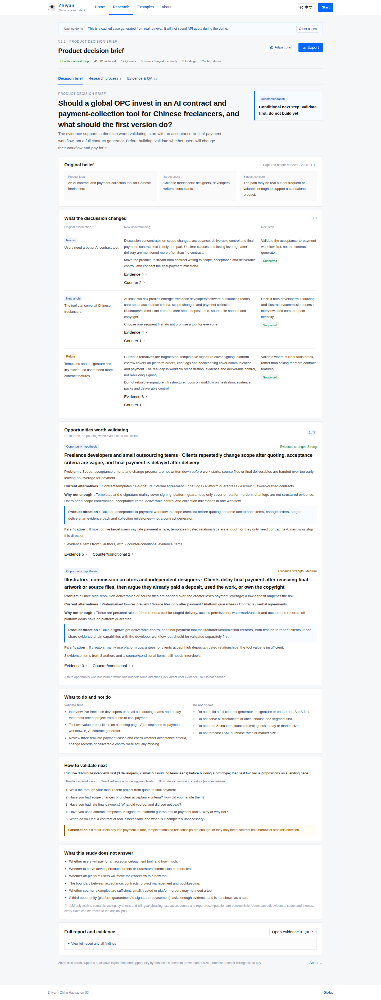
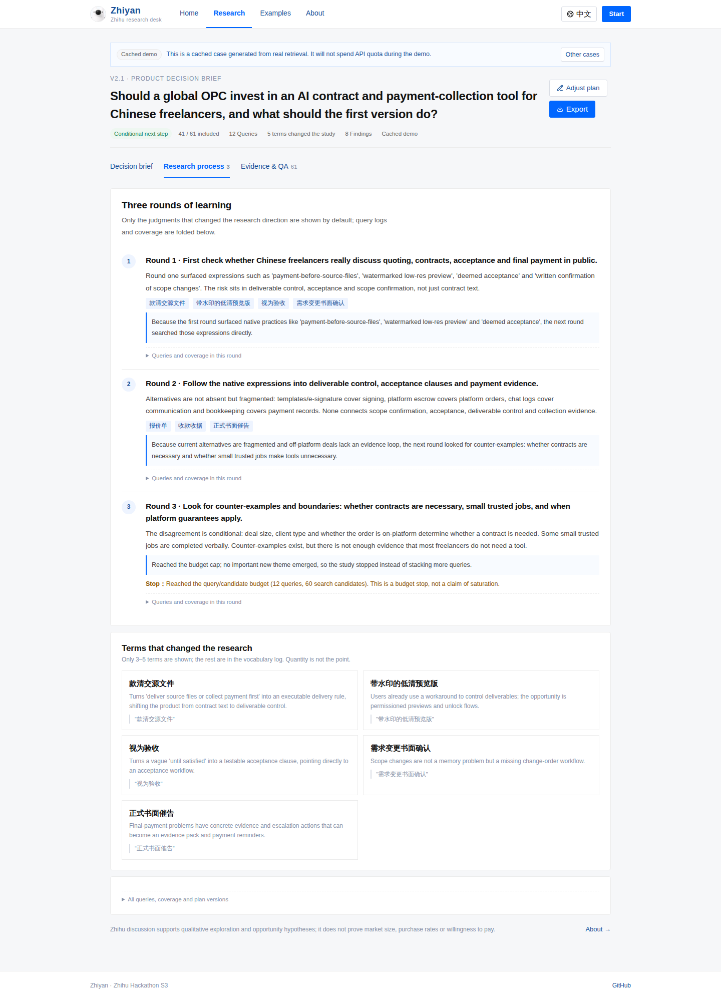
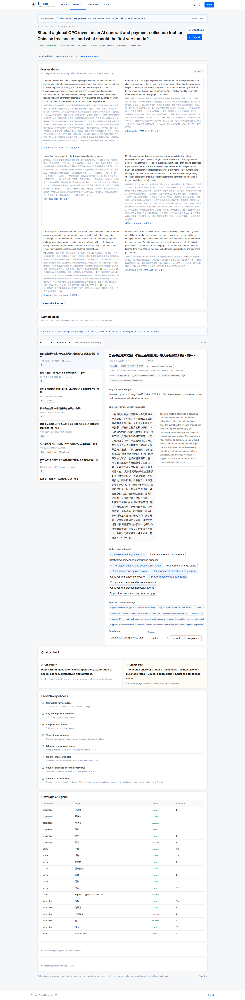
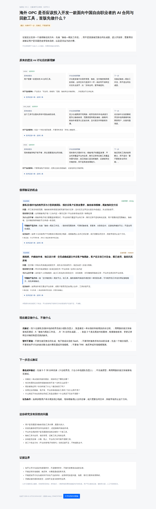

# 知研台 Zhiyan V2.1

**面向全球 OPC 的知乎研究台。**
把英文产品决策变成中文研究计划、适应性知乎检索，以及一份能改变产品判断的双语决策简报。

> A research team for global builders, built on real Zhihu conversations.

- **主案例（真实检索缓存）**：海外 OPC × 中国自由职业者，AI 合同与回款工具是否值得做
- **主报赛道**：AI × 出海；能力底色：AI × 知识与探索
- **V2.1 任务书**：[DeepSeek 开发任务书](<docs/知研台_V2.1_DeepSeek开发任务书.md>)
- **一页决策简报样例**：[main-case-decision-brief.html](<docs/v2.1/main-case-decision-brief.html>)
- **质量审计**：[quality-audit.md](<docs/v2.1/quality-audit.md>)
- **GitHub**：<https://github.com/er-s-an/zhiyan>

## 它解决什么

V2.1 默认打开的不是研究日志，而是**决策简报**。首屏先给三格速览（先验证什么、讨论改变什么、下一步），再展开第一机会卡和认知更新。它按顺序回答：

1. 我原来的想法是什么（检索前捕获，不允许事后倒写）。
2. 讨论让问题理解发生了什么变化（最多 3 条认知更新）。
3. 出现了哪些值得验证的机会（最多 3 张机会卡，证据不足不凑数）。
4. 现在建议做什么、不做什么。
5. 这份研究没有回答什么，下一步如何低成本证伪。

底层仍然执行真实研究：方法适用闸门、适应性检索、新词来源、反例、人工可接管证据和双语报告。差别是这些不再占据第一屏。

P0 明确不做市场规模、购买率、Conjoint/MaxDiff、多平台接入、自动访谈、SSO 和多 Agent 聊天界面。

## 界面

| 决策简报 | 研究过程 |
|---|---|
|  |  |

| 证据与质检 | 一页手工样例 |
|---|---|
|  |  |

## 演示

```bash
npm install
cp .env.example .env.local   # 填入知乎 Access Secret 与 LLM 配置
npm run dev                  # http://localhost:3000
```

- 首页：`/`（内置 10 个可随机切换的产品问题，点「随机换一个」即可试玩）
- 用户访谈：`/interview`（支持中 / 英 / 法 / 日；先了解年龄与目前在做的事，再聊想法、用户、问题、市场、优势、收费与验证，然后给出可行性初判）
- 落地方案：`/action-plan`（把访谈和研究台证据合成 MVP、商业模式、12 周路线图、验证实验与停止条件）
- 主案例缓存：`/workbench?demo=main-case`（离线可用，不消耗接口）
- 示例库：`/examples`
- 产品说明：`/plan`
- 实时路径：首页输入英文 Brief → 研究计划 → 选择「轻量实时后台任务」确认。确认后立即创建任务，页面边跑边看轮次快照；5 分钟演示请使用缓存主案例。
- 已实测的后台任务：7 次真实查询、31 条候选、26 条纳入、8 条发现、3 轮快照；任务创建后立即返回，完整完成约 530 秒。

## 用户访谈

`/interview` 是 V2.1 之后新增的对话式入口：先了解“你是谁”，再把你想做的生意聊清楚，最后给一份**研究初判**，而不是直接下“可行/不可行”的结论。

- 访谈顺序：年龄 → 目前在做的事 → 想做什么 → 谁最需要 → 什么场景下遇到什么问题 → 用户在哪里 → 为什么是你 → 怎么赚钱 → 做过什么验证 → 要做什么决定/何时停 → 投入多少时间与预算。
- 每一步回答后，会通过本机 OpenCode API 把下一题自然地重新问出来（保留原题核心意图）；本地 API 不可用时退回固定问题，不阻塞流程。
- 初判维度：想法清晰度、目标用户、问题强度、市场与数据、你的优势、商业模式、已有验证、决策与止损。
- 输出：0–100 初判分、主要风险、下一步建议、必须验证的三件事、知乎方法适配与允许输出级别。
- 可继续：点击「生成研究计划」会把访谈整理成 brief，并带着市场/用户覆盖进入 `/design` 的方法闸门；也可导出 Markdown 访谈纪要。
- 隐私：回答只保存在浏览器 `localStorage`，可随时重新开始。
- 语言：问题、选项、初判、风险 / 下一步、导出纪要、以及本机模型生成的下一题问法都支持中文、English、Français、日本語、Русский、한국어。

### 多语言

顶部语言选择器提供 `中文 / English / Français / 日本語 / Русский / 한국어`。访谈主流程、研究搭子和导航已覆盖六语；旧的研究台 / 示例页以及部分评估细节对法语、日语、俄语、韩语暂时回退到英文，后续可按同一套 `Lang`、`LocalizedText` 与 `lib/v2/lang.ts` 词典继续补全。

实现：`lib/v2/interview.ts`（问题脚本、评分、Markdown）、`app/interview/page.tsx`（对话界面）、`app/api/v2/interview/route.ts`（将访谈转成研究计划）、`app/api/v2/interview/coach/route.ts` 与 `lib/v2/server/opencode.ts`（本机 OpenCode 生成下一题问法）。访谈评分是确定性逻辑，不依赖模型；模型只负责让对话更自然，不会改写评分。

### 侧边研究搭子

- 任意页面右下角有「研究搭子」；打开是右侧聊天抽屉，关闭后不打断研究。
- 默认不是 11 题问卷，而是三个入口：
  - **帮我理清一个想法**：4 个快速问题 → 一句可编辑 brief → 可直接生成研究计划
  - **基于当前上下文，下一步做什么**：有研究时读取机会假设、证据和下一步验证；只有访谈初判时用初判回答；都没有时明确说不知道
  - **做一次完整访谈**：在主窗口打开 `/interview`
- 对话、brief、澄清答案都存在 `localStorage`，刷新或关掉再打开会恢复。
- 澄清的 4 个答案会自动带入完整访谈：到对应问题自动填入，用户可修改后再发送，不重复回答。
- brief 可编辑、可复制；生成研究计划使用编辑后的版本。
- 回答后可一键：**生成访谈提纲**（5 个问题 + 各自验证什么）、**查看证据**（有研究时）、**加入方案**；加入的内容会出现在 `/action-plan` 的「研究搭子的补充观察」并进入 Markdown 导出。
- 只有「做一次完整访谈」才进入 11 题流程；研究台不需要访谈也能独立使用。

## 落地方案

访谈和研究是两条独立路径：研究搭子常驻右下角，研究台保持原来的独立流程（首页 Brief → 研究计划 → 研究台）。完整访谈和落地方案是主动打开的深流程。

```text
研究搭子（右下角，随时打开）
  ├─ 快速澄清 4 问 → 一句 brief → 研究计划（可选）
  └─ 基于当前研究回答下一步
完整访谈（/interview，主动打开）→ 初判 / 落地方案
研究计划（/design）→ 研究台（/workbench，机会假设、证据、反证）
        ↓ 完整访谈结果里的「先看方案」
落地方案（/action-plan：定位 / MVP / 商业模式 / 12 周路线图 / 实验 / 停止条件）
```

- 打开即有「规则版」方案：不等模型，先给出可执行的 MVP 范围、路线图、实验和停止条件。
- 点「本地模型润色」后，用本机 OpenCode 模型把规则版改写成更自然、更具体的方案（实测约 10–20 秒）；失败时保留规则版。
- 合并规则：只有研究台的案例与访谈内容匹配时才采用其机会假设；不匹配时明确标注，不把缓存案例当作你的证据。
- 输出：一句话定位、首个切入人群、必须做 / 验证后再加 / 现在不做、商业模式与第一批付费者、12 周路线图、验证实验、证据与缺口、风险、停止条件、接下来 7 天。
- 可导出 Markdown；结果按访谈内容 + 研究 + 语言缓存。
- 入口：任意页面右下角「研究搭子」；完整访谈结果页的「先看方案（仅访谈）」是研究前的预览，研究完成后回到方案页会自动合并证据。研究台不再承担方案入口。

实现：`lib/v2/action-plan.ts`（合成、匹配、Markdown）、`app/api/v2/action-plan/route.ts`（本机模型润色）、`app/action-plan/page.tsx`（方案界面）。默认润色模型为 `minimax-m3.1-flash`，可用 `OPENCODE_PLAN_MODEL` / `OPENCODE_PLAN_VARIANT` 覆盖。

研究搭子实现：`lib/v2/dock.ts`（快速澄清、研究上下文、降级回答）、`app/api/v2/dock/route.ts`（本机模型）、`app/components/InterviewDock.tsx`（侧边聊天），默认模型同为 `minimax-m3.1-flash`，可用 `OPENCODE_DOCK_MODEL` / `OPENCODE_DOCK_VARIANT` 覆盖。

## 当前主案例

| 指标 | 值 |
|---|---:|
| 真实检索查询 | 12 次（3 轮，含 1 次反例） |
| 候选样本 | 61（搜索 60 + 热榜 1） |
| 纳入样本 | 41（清理 6 条营销/无具体经历内容后，纳入率 67.2%） |
| 从样本中发现的新词 | 12 个（全部带来源样本与原句） |
| 计划版本 | 3 版 |
| 六类发现 | 8 条（保留在完整报告） |
| V2.1 决策简报 | 3 条认知更新 · 2 张机会卡 · 2 个产品选项 |
| 后台任务实测 | 3 轮快照 · 31 候选 · 26 纳入 · 8 发现 |
| 候选计数 | 搜索 60 + 热榜 1 = 61 条候选样本 |
| 交付 | 中英双语 Decision Memo + 完整报告 + 证据附录 |

主案例展示了 PRD 要求的「哇时刻」：系统从真实讨论中发现用户原本不会想到的中文表达，例如：

- 款清交源文件
- 带水印的低清预览版
- 视为验收条款
- 需求变更书面确认
- 资金托管
- 正式书面催告

这些词不是预先写进 Prompt 的同义词，而是从真实样本中提取、带来源样本 ID 和原句，并触发了后续查询。

## 目录

```
app/                 页面与 Route Handlers
app/components/      知乎式顶栏、语言切换、访谈侧边助手、刘看山组件
app/interview/       对话式用户访谈与可行性初判
app/action-plan/     访谈 × 研究台合成的落地方案
app/workbench/       决策简报 / 研究过程 / 证据与质检
lib/v2/              V2/V2.1 领域层：计划、方法闸门、适应性检索、编码、发现、决策简报
lib/v2/interview.ts  访谈问题脚本、确定性初判与访谈纪要导出
lib/v2/lang.ts       俄语 / 韩语覆盖词典（按英文源字符串映射）
lib/v2/dock.ts       研究搭子：快速澄清、研究上下文与降级回答
lib/v2/action-plan.ts 访谈 × 研究台的落地方案合成、匹配与导出
lib/v2/server/opencode.ts 本机 OpenCode 文本生成客户端（仅服务端）
lib/v2/briefs/       主案例真实 DecisionBrief JSON
docs/v2.1/           Gate A 样例、证据映射、质量审计、用户测试与对照协议
lib/v2/demos/        主案例真实检索缓存
scripts/seed-v2.ts   生成主案例缓存
scripts/refine-v2.ts 在不重跑检索的情况下重生成发现/报告
scripts/verify-v2.ts 端到端验收脚本
scripts/verify-v21.ts V2.1 决策简报验收脚本
scripts/build-v21-brief.ts 从真实主案例生成 DecisionBrief
scripts/audit-v21.ts 证据质量审计
docs/                V2 PRD、产品说明、UI/UX、专业调研对照
```

## 服务端配置

`.env.local`（不提交）：

```dotenv
ZHIHU_ACCESS_SECRET=        # 知乎开放平台
LLM_BASE_URL=               # OpenAI 兼容地址
LLM_API_KEY=                # 模型 Key
LLM_MODEL=deepseek-v4.1-flash

# 可选：访谈问法走本机 OpenCode 服务
OPENCODE_BASE_URL=          # 默认读取 ~/.local/state/opencode/service.json
OPENCODE_PASSWORD=          # 默认读取同一文件，切勿提交
OPENCODE_MODEL=deepseek-v4.1-flash
OPENCODE_PROVIDER=opencode-go
OPENCODE_VARIANT=low
OPENCODE_COACH_MODEL=minimax-m3.1-flash  # 下一题问法用更快的模型
OPENCODE_COACH_VARIANT=low
OPENCODE_PLAN_MODEL=minimax-m3.1-flash   # 落地方案润色
OPENCODE_PLAN_VARIANT=low
OPENCODE_DOCK_MODEL=minimax-m3.1-flash   # 研究搭子
OPENCODE_DOCK_VARIANT=low
# 日语 / 俄语 / 韩语默认改用 glm-5.3-flash，避免混入中文
OPENCODE_COACH_MODEL_MULTILINGUAL=glm-5.3-flash
OPENCODE_PLAN_MODEL_MULTILINGUAL=glm-5.3-flash
OPENCODE_DOCK_MODEL_MULTILINGUAL=glm-5.3-flash
```

访谈问法生成默认用 `minimax-m3.1-flash`（实测 1–3 秒）；如果该模型不可用，会自动回退到 `OPENCODE_MODEL`。

本机运行时通常不需要填写 `OPENCODE_*`：服务端会自动读取 OpenCode 的 `service.json`，并用 Basic 认证调用 `POST /api/experimental/generate/text`。密码只在 Next.js 服务端使用，不会发到浏览器；部署到没有该服务的机器时，问法会自动降级为固定问题。

> 注意：`/api/v2/interview/coach` 会使用本机 OpenCode 凭据。它只适合本机开发与演示，不要把带该路由的服务暴露到公网。

- 知乎能力：`zhihu_search`、`hot_list`、`zhida`。热榜只在相关时纳入，直答只做补漏提示，不进入发现。
- LLM 负责：拆 Brief、从真实样本扩展词汇、辅助语义编码、生成发现/双语报告与访谈建议。
- 确定性逻辑负责：查询白名单/预算/版本、样本去重与筛选、编码关联、计数、证据完整性、重算与导出。

## 验证

```bash
npm test          # 37 个测试：旧版回归 + 闸门/计划版本/适应性检索/双语/重算 + V2.1 简报 + 六语访谈 + 落地方案 + 研究搭子
npm run build
npx tsx scripts/verify-v21.ts --base http://127.0.0.1:3211
npx tsx scripts/verify-v2.ts --base http://127.0.0.1:3211 --skip-plan
```

`verify-v2` 检查：缓存主案例、方法闸门、真实查询轮次与反例、新词来源、六类发现与双语一致性、搁置样本后报告重算、未确认拒绝。V2.1 另见 `docs/v2.1/acceptance-checklist.md`、`docs/v2.1/gate-a-checklist.md`、`docs/v2.1/job-acceptance.md` 与浏览器截图。

真实主案例由 `scripts/seed-v2.ts` 使用知乎官方接口 + LLM 生成，已完整跑通并写入 `lib/v2/demos/main-case.json`。

## V2.1 文档

- [V2.1 开发任务书](<docs/知研台_V2.1_DeepSeek开发任务书.md>)
- [一页决策简报样例](<docs/v2.1/main-case-decision-brief.html>)
- [证据映射](<docs/v2.1/evidence-map.md>)
- [质量审计](<docs/v2.1/quality-audit.md>)
- [验收清单](<docs/v2.1/acceptance-checklist.md>)
- [后台任务验收](<docs/v2.1/job-acceptance.md>)
- [用户测试脚本](<docs/v2.1/user-test-script.md>)
- [对照评估协议](<docs/v2.1/comparison-protocol.md>)

## 与 V1 的关系

V1 的知乎蓝白 UI、刘看山 IP、确认门、样本工作台和缓存机制被复用；四个旧案例降级为辅助案例，不再承担主叙事。旧版接口与测试保留，避免回归。

## 说明

- 知乎公开讨论适合定性探索，不能证明市场规模、购买率、因果关系或整体人群分布。
- 不生产垃圾回答、不批量发帖、不绕过平台抓取内容；保留作者、出处和原文链接。
- 刘看山素材来自知乎黑客松 S3 官方素材包，仅用于本次参赛作品。
