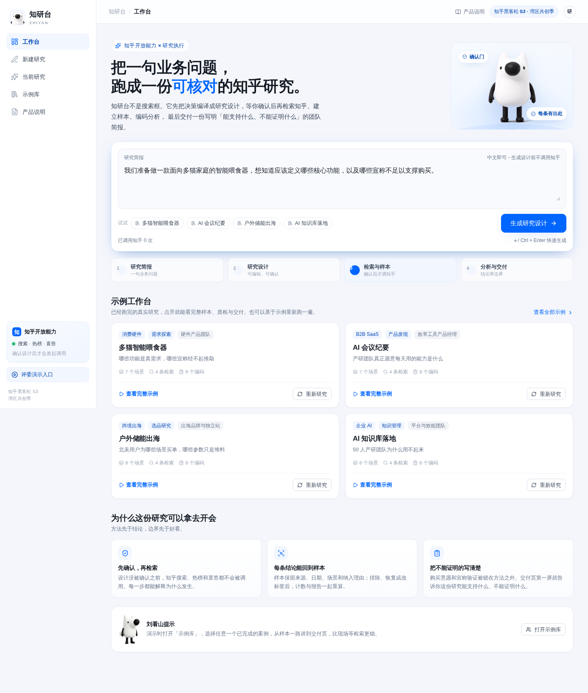
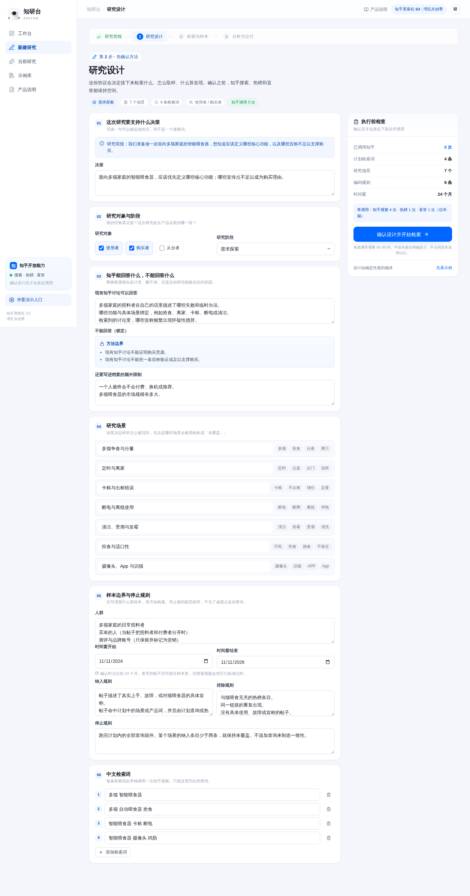
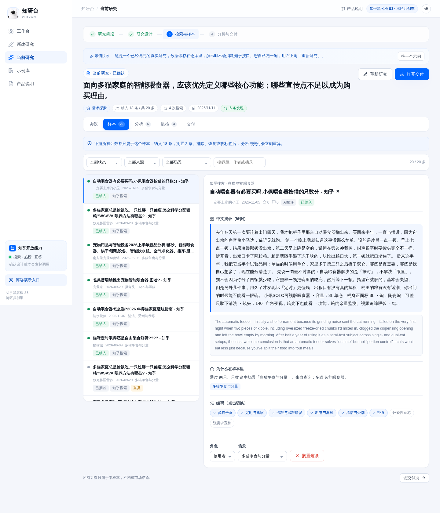
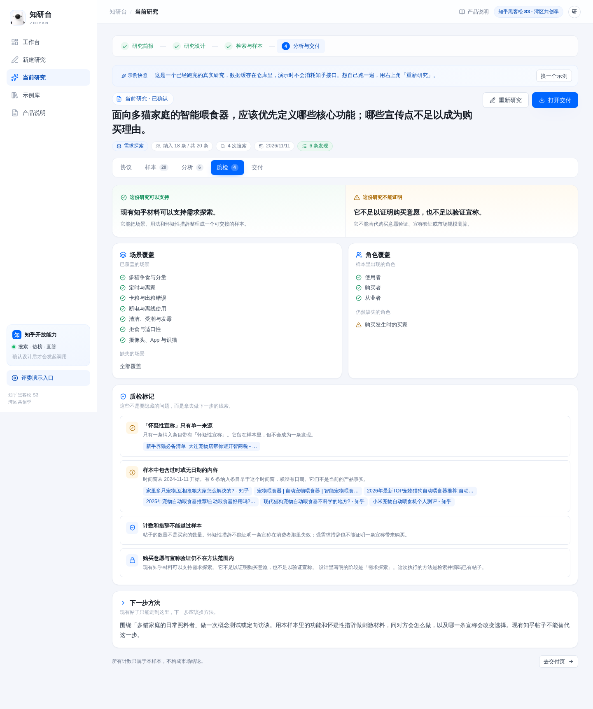

# 知研台 Zhiyan

**把一句业务问题，跑成一份可核对的知乎研究。**

知研台是一个面向产研团队的研究执行工作台。用户交来的是一句商业决策，不是一个搜索词。系统先把决策编译成一份可编辑的研究设计；确认之后，才检索知乎、热榜核对、直答补漏，建立样本、编码、质检，最后交付一份写明边界的团队研究简报。

知乎黑客松 S3 · 湾区共创季 · **AI × 知识与探索**

- 公开演示：<https://zhiyan-five.vercel.app>
- 产品说明计划书：[docs/产品说明计划书.md](docs/产品说明计划书.md)
- 示例库：`/examples`（四个真实检索快照，离线可演示）

## 为什么是它

- **先确认，再检索**：设计没确认前，知乎搜索、热榜、直答都不会被调用；服务端每次检索都会重新校验设计。
- **每条结论有出处**：样本保留来源、日期、场景、纳入理由和编码；排除、恢复或改标签后，计数与报告一起重算。
- **把不能证明的写清楚**：购买意愿与宣称验证被锁在方法之外；质检页和交付页首屏都写着「可以支持 / 不能证明」。
- **为演示准备的真实案例**：消费硬件、B2B SaaS、跨境出海、企业 AI 四个案例，均已通过真实知乎接口检索并缓存。

## 界面

知乎蓝白主题，中文优先，左侧工作台导航 + 顶部路径 + 内容卡片。品牌位、空态和提示使用刘看山官方三视图素材。

| 工作台 | 研究设计 |
| --- | --- |
|  |  |

| 样本 | 质检 |
| --- | --- |
|  |  |

## 快速开始

要求 Node.js 20+。

```bash
npm install
cp .env.example .env.local   # 填入知乎 Access Secret 与本机 LLM 配置
npm run dev                  # http://localhost:3000
```

没有服务端密钥也能打开页面和示例库；只有「确认并检索」会提示未配置。

服务端变量（只放在 `.env.local`，不要提交）：

```dotenv
ZHIHU_ACCESS_SECRET=        # 知乎开放平台个人中心生成
LLM_BASE_URL=               # OpenAI 兼容地址
LLM_API_KEY=                # 模型 Key
LLM_MODEL=deepseek-v4.1-flash
```

模型只负责把中文摘录译成英文；研究设计、编码、计数和边界由确定性代码生成。LLM 失败时保留中文证据并标注，不影响分析。

## 使用知乎开放能力

| 能力 | 用途 | 边界 |
| --- | --- | --- |
| 知乎搜索 `zhihu_search` | 按已确认设计中的每条中文检索词取样 | 每条计划查询一次，不把服务端密钥变成开放搜索代理 |
| 热榜 `hot_list` | 核对当天站内议程，与本品无关的标题只记入扫描记录 | 热榜必须调用，失败则不生成研究 |
| 直答 `zhida` | 只根据已检索标题提示可能漏掉的场景 | 不进入发现，不进入报告正文，`usedAsFinding: false` |

不写接口、不发帖、不批量操作。查询额度以知乎开放平台个人中心为准，调用前请做好缓存和去重。

## 示例数据

`lib/demos/*.json` 是四个已跑完的研究快照，由 `scripts/seed-demos.ts` 通过真实知乎接口生成：

```bash
npx tsx scripts/seed-demos.ts                 # 重新生成全部（需要 .env.local）
npx tsx scripts/seed-demos.ts --only=ai-meeting
```

示例库页面通过 `/api/demos` 读取，不依赖现场网络和额度；每个案例仍保留「重新研究」路径。

## 验证

```bash
npm test                                      # 领域测试
npm run build                                 # 生产构建
npx tsx .cursor/skills/verify-zhiyan/scripts/verify.ts --base http://127.0.0.1:3210 --study lib/demos/smart-feeder.json
```

`verify-zhiyan` 覆盖确认门、设计外查询拒绝、真实快照投影、示例库和四个案例的中文场景包。浏览器里再走一遍：提交简报 → 设计 → 确认检索 → 样本 → 分析 → 质检 → 交付，并测试排除一条后计数与报告变化。

## 目录

```
app/                 页面与 Route Handlers（工作台、研究设计、当前研究、示例库、产品说明）
app/components/      应用外壳、步骤条、刘看山组件
app/workbench/       协议、样本、分析、质检、交付五个视图
lib/                 领域层：编译、样本、投影、类型、场景、本地存储
lib/server/          知乎与 LLM 服务端适配
lib/demos/           四个真实研究快照 + index
scripts/             示例数据生成脚本
design-system/       UI/UX Pro Max 生成并覆写为知乎蓝白的设计系统
docs/                产品说明计划书、UI/UX Skill 使用记录、截图
public/brand/        刘看山官方三视图处理后的透明素材
```

## UI/UX Skill

按任务要求安装并实测了 [UI/UX Pro Max](https://github.com/nextlevelbuilder/ui-ux-pro-max-skill)：设计系统生成、domain 搜索、Next.js stack 指引均完整跑通。安装与验收命令见 [docs/uiux-skill.md](docs/uiux-skill.md)。

## 说明

- 示例快照中的中文摘录来自公开知乎内容，用于演示研究方法；引用请回到原链接。
- 刘看山素材来自知乎黑客松 S3 官方素材包，仅用于本次参赛作品。
- 本项目不把一次样本当作市场规模、购买意愿或宣称验证的证明。
