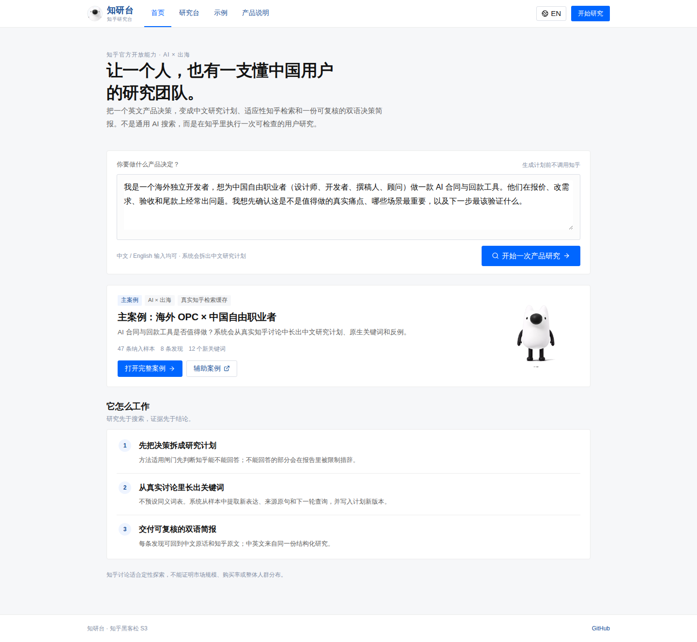
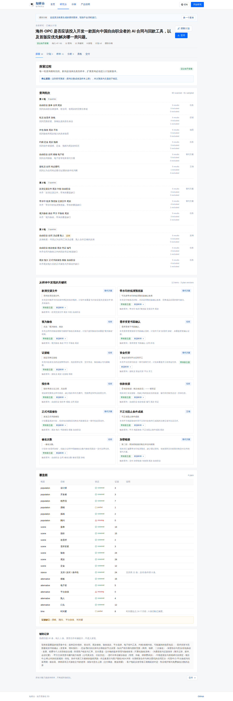
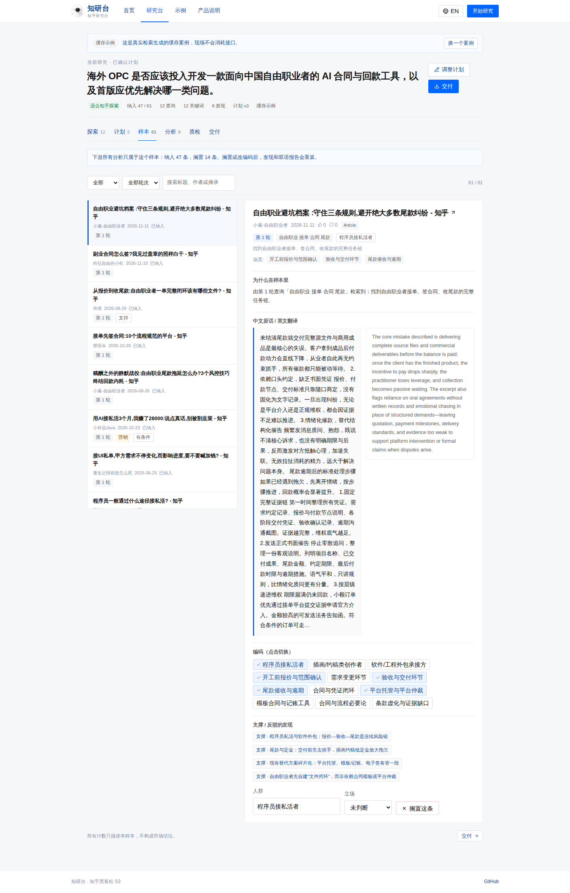
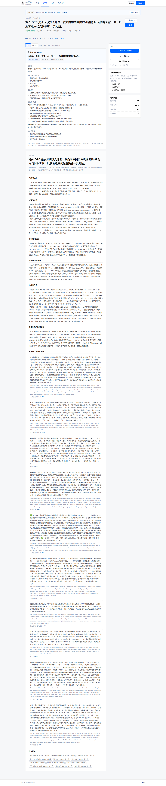

# 知研台 Zhiyan V2

**面向全球 OPC 的知乎研究台。**
把英文产品决策变成中文研究计划、适应性知乎检索和一份可复核的双语决策简报。

> A research team for global builders, built on real Zhihu conversations.

- **主案例（真实检索缓存）**：海外 OPC × 中国自由职业者，AI 合同与回款工具是否值得做
- **主报赛道**：AI × 出海；能力底色：AI × 知识与探索
- **产品说明**：[V2 PRD](<docs/知研台_V2_PRD_全球OPC与知乎知识出海.md>)
- **GitHub**：<https://github.com/er-s-an/zhiyan>

## 它解决什么

通用 AI 可以读到部分公开网页，也可能搜到部分知乎内容。知研台的差别不是模型会不会搜索，而是**系统是否真的执行一次研究**：

1. **方法适用闸门**：先判断知乎能不能回答，不能回答的部分限制报告措辞。
2. **适应性检索**：种子查询 → 读真实样本 → 提取新词与来源原句 → 写入计划新版本 → 补覆盖/找反例 → 预算内停止。
3. **可接管证据**：用户可以搁置样本、修改编码、改主题；发现、计数和双语报告同步重算。
4. **双语决策交付**：Decision Memo + 关键发现 + 反例/缺口 + 中文原话/英文翻译 + 下一步验证与证伪条件。

P0 明确不做市场规模、购买率、Conjoint/MaxDiff、多平台接入、自动访谈、SSO 和多 Agent 聊天界面。

## 界面

| 首页（中文） | 探索 |
|---|---|
|  |  |

| 样本工作台 | 双语交付 |
|---|---|
|  |  |

## 演示

```bash
npm install
cp .env.example .env.local   # 填入知乎 Access Secret 与 LLM 配置
npm run dev                  # http://localhost:3000
```

- 首页：`/`
- 主案例缓存：`/workbench?demo=main-case`（离线可用，不消耗接口）
- 示例库：`/examples`
- 产品说明：`/plan`
- 实时路径：首页输入英文 Brief → 研究计划 → 选择「轻量实时检索」确认。实时路径会真实调用知乎和 LLM，通常 10–15 分钟；5 分钟演示请使用缓存主案例。
- 已实测的实时路径：7 次真实查询、29 条候选、26 条纳入、9 个有来源新词、8 条发现，完整返回约 9 分钟。

## 当前主案例

| 指标 | 值 |
|---|---:|
| 真实检索查询 | 12 次（3 轮，含 1 次反例） |
| 候选样本 | 60 |
| 纳入样本 | 47 |
| 从样本中发现的新词 | 12 个（全部带来源样本与原句） |
| 计划版本 | 3 版 |
| 六类发现 | 8 条（含反例/条件性证据） |
| 交付 | 中英双语 Decision Memo + 完整报告 + 证据附录 |

主案例展示了 PRD 要求的「哇时刻」：系统从真实讨论中发现用户原本不会想到的中文表达，例如：

- 款清交源文件
- 带水印的低清预览版
- 视为验收条款
- 需求变更书面确认
- 资金托管
- 正式书面催告

这些词不是预先写进 Prompt 的同义词，而是从真实样本中提取、带来源样本 ID 和原句，并触发了后续查询。

## 目录

```
app/                 页面与 Route Handlers
app/components/      知乎式顶栏、语言切换、刘看山组件
app/workbench/       Explore / Plan / Sample / Analysis / Quality / Delivery
lib/v2/              V2 领域层：计划、方法闸门、适应性检索、编码、发现、双语报告
lib/v2/demos/        主案例真实检索缓存
scripts/seed-v2.ts   生成主案例缓存
scripts/refine-v2.ts 在不重跑检索的情况下重生成发现/报告
scripts/verify-v2.ts 端到端验收脚本
docs/                V2 PRD、产品说明、UI/UX、专业调研对照
```

## 服务端配置

`.env.local`（不提交）：

```dotenv
ZHIHU_ACCESS_SECRET=        # 知乎开放平台
LLM_BASE_URL=               # OpenAI 兼容地址
LLM_API_KEY=                # 模型 Key
LLM_MODEL=deepseek-v4.1-flash
```

- 知乎能力：`zhihu_search`、`hot_list`、`zhida`。热榜只在相关时纳入，直答只做补漏提示，不进入发现。
- LLM 负责：拆 Brief、从真实样本扩展词汇、辅助语义编码、生成发现/双语报告与访谈建议。
- 确定性逻辑负责：查询白名单/预算/版本、样本去重与筛选、编码关联、计数、证据完整性、重算与导出。

## 验证

```bash
npm test          # 14 个测试：旧版回归 + 闸门/计划版本/适应性检索/双语/重算
npm run build
npx tsx scripts/verify-v2.ts --base http://127.0.0.1:3210 --skip-plan
```

`verify-v2` 检查：缓存主案例、方法闸门、真实查询轮次与反例、新词来源、六类发现与双语一致性、搁置样本后报告重算、未确认拒绝。

真实主案例由 `scripts/seed-v2.ts` 使用知乎官方接口 + LLM 生成，已完整跑通并写入 `lib/v2/demos/main-case.json`。

## 与 V1 的关系

V1 的知乎蓝白 UI、刘看山 IP、确认门、样本工作台和缓存机制被复用；四个旧案例降级为辅助案例，不再承担主叙事。旧版接口与测试保留，避免回归。

## 说明

- 知乎公开讨论适合定性探索，不能证明市场规模、购买率、因果关系或整体人群分布。
- 不生产垃圾回答、不批量发帖、不绕过平台抓取内容；保留作者、出处和原文链接。
- 刘看山素材来自知乎黑客松 S3 官方素材包，仅用于本次参赛作品。
