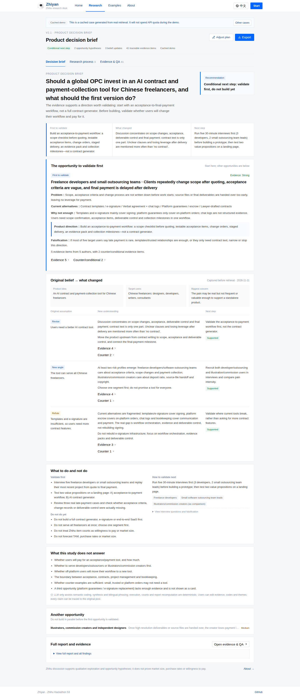
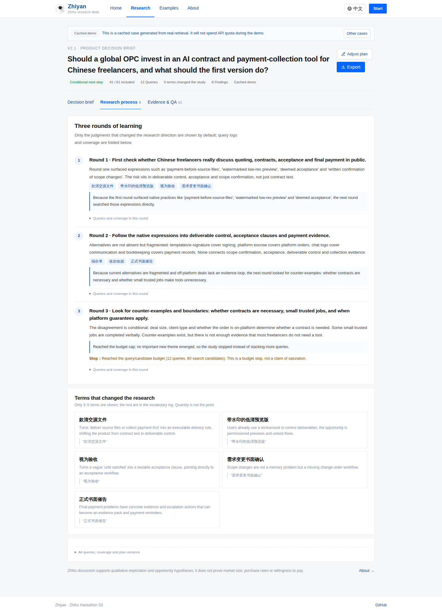
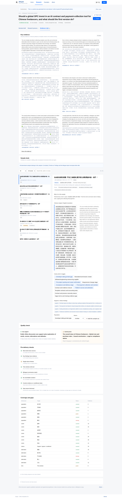
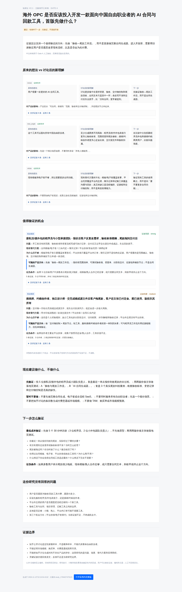

# 知研台 Zhiyan V2.1

**面向全球 OPC 的知乎研究台。**
把英文产品决策变成中文研究计划、适应性知乎检索，以及一份能改变产品判断的双语决策简报。

> A research team for global builders, built on real Zhihu conversations.

- **主案例（真实检索缓存）**：海外 OPC × 中国自由职业者，AI 合同与回款工具是否值得做
- **主报赛道**：AI × 出海；能力底色：AI × 知识与探索
- **V2.1 任务书**：[DeepSeek 开发任务书](<docs/知研台_V2.1_DeepSeek开发任务书.md>)
- **一页决策简报样例**：[main-case-decision-brief.html](<docs/v2.1/main-case-decision-brief.html>)
- **质量审计**：[quality-audit.md](<docs/v2.1/quality-audit.md>)
- **GitHub**：<https://github.com/er-s-an/zhiyan>

## 它解决什么

V2.1 默认打开的不是研究日志，而是**决策简报**。首屏先给三格速览（先验证什么、讨论改变什么、下一步），再展开第一机会卡和认知更新。它按顺序回答：

1. 我原来的想法是什么（检索前捕获，不允许事后倒写）。
2. 讨论让问题理解发生了什么变化（最多 3 条认知更新）。
3. 出现了哪些值得验证的机会（最多 3 张机会卡，证据不足不凑数）。
4. 现在建议做什么、不做什么。
5. 这份研究没有回答什么，下一步如何低成本证伪。

底层仍然执行真实研究：方法适用闸门、适应性检索、新词来源、反例、人工可接管证据和双语报告。差别是这些不再占据第一屏。

P0 明确不做市场规模、购买率、Conjoint/MaxDiff、多平台接入、自动访谈、SSO 和多 Agent 聊天界面。

## 界面

| 决策简报 | 研究过程 |
|---|---|
|  |  |

| 证据与质检 | 一页手工样例 |
|---|---|
|  |  |

## 演示

```bash
npm install
cp .env.example .env.local   # 填入知乎 Access Secret 与 LLM 配置
npm run dev                  # http://localhost:3000
```

- 首页：`/`（内置 10 个可随机切换的产品问题，点「随机换一个」即可试玩）
- 主案例缓存：`/workbench?demo=main-case`（离线可用，不消耗接口）
- 示例库：`/examples`
- 产品说明：`/plan`
- 实时路径：首页输入英文 Brief → 研究计划 → 选择「轻量实时后台任务」确认。确认后立即创建任务，页面边跑边看轮次快照；5 分钟演示请使用缓存主案例。
- 已实测的后台任务：7 次真实查询、31 条候选、26 条纳入、8 条发现、3 轮快照；任务创建后立即返回，完整完成约 530 秒。

## 当前主案例

| 指标 | 值 |
|---|---:|
| 真实检索查询 | 12 次（3 轮，含 1 次反例） |
| 候选样本 | 61（搜索 60 + 热榜 1） |
| 纳入样本 | 41（清理 6 条营销/无具体经历内容后，纳入率 67.2%） |
| 从样本中发现的新词 | 12 个（全部带来源样本与原句） |
| 计划版本 | 3 版 |
| 六类发现 | 8 条（保留在完整报告） |
| V2.1 决策简报 | 3 条认知更新 · 2 张机会卡 · 2 个产品选项 |
| 后台任务实测 | 3 轮快照 · 31 候选 · 26 纳入 · 8 发现 |
| 候选计数 | 搜索 60 + 热榜 1 = 61 条候选样本 |
| 交付 | 中英双语 Decision Memo + 完整报告 + 证据附录 |

主案例展示了 PRD 要求的「哇时刻」：系统从真实讨论中发现用户原本不会想到的中文表达，例如：

- 款清交源文件
- 带水印的低清预览版
- 视为验收条款
- 需求变更书面确认
- 资金托管
- 正式书面催告

这些词不是预先写进 Prompt 的同义词，而是从真实样本中提取、带来源样本 ID 和原句，并触发了后续查询。

## 目录

```
app/                 页面与 Route Handlers
app/components/      知乎式顶栏、语言切换、刘看山组件
app/workbench/       决策简报 / 研究过程 / 证据与质检
lib/v2/              V2/V2.1 领域层：计划、方法闸门、适应性检索、编码、发现、决策简报
lib/v2/briefs/       主案例真实 DecisionBrief JSON
docs/v2.1/           Gate A 样例、证据映射、质量审计、用户测试与对照协议
lib/v2/demos/        主案例真实检索缓存
scripts/seed-v2.ts   生成主案例缓存
scripts/refine-v2.ts 在不重跑检索的情况下重生成发现/报告
scripts/verify-v2.ts 端到端验收脚本
scripts/verify-v21.ts V2.1 决策简报验收脚本
scripts/build-v21-brief.ts 从真实主案例生成 DecisionBrief
scripts/audit-v21.ts 证据质量审计
docs/                V2 PRD、产品说明、UI/UX、专业调研对照
```

## 服务端配置

`.env.local`（不提交）：

```dotenv
ZHIHU_ACCESS_SECRET=        # 知乎开放平台
LLM_BASE_URL=               # OpenAI 兼容地址
LLM_API_KEY=                # 模型 Key
LLM_MODEL=deepseek-v4.1-flash
```

- 知乎能力：`zhihu_search`、`hot_list`、`zhida`。热榜只在相关时纳入，直答只做补漏提示，不进入发现。
- LLM 负责：拆 Brief、从真实样本扩展词汇、辅助语义编码、生成发现/双语报告与访谈建议。
- 确定性逻辑负责：查询白名单/预算/版本、样本去重与筛选、编码关联、计数、证据完整性、重算与导出。

## 验证

```bash
npm test          # 16 个测试：旧版回归 + 闸门/计划版本/适应性检索/双语/重算 + V2.1 简报
npm run build
npx tsx scripts/verify-v21.ts --base http://127.0.0.1:3211
npx tsx scripts/verify-v2.ts --base http://127.0.0.1:3211 --skip-plan
```

`verify-v2` 检查：缓存主案例、方法闸门、真实查询轮次与反例、新词来源、六类发现与双语一致性、搁置样本后报告重算、未确认拒绝。V2.1 另见 `docs/v2.1/acceptance-checklist.md`、`docs/v2.1/gate-a-checklist.md`、`docs/v2.1/job-acceptance.md` 与浏览器截图。

真实主案例由 `scripts/seed-v2.ts` 使用知乎官方接口 + LLM 生成，已完整跑通并写入 `lib/v2/demos/main-case.json`。

## V2.1 文档

- [V2.1 开发任务书](<docs/知研台_V2.1_DeepSeek开发任务书.md>)
- [一页决策简报样例](<docs/v2.1/main-case-decision-brief.html>)
- [证据映射](<docs/v2.1/evidence-map.md>)
- [质量审计](<docs/v2.1/quality-audit.md>)
- [验收清单](<docs/v2.1/acceptance-checklist.md>)
- [后台任务验收](<docs/v2.1/job-acceptance.md>)
- [用户测试脚本](<docs/v2.1/user-test-script.md>)
- [对照评估协议](<docs/v2.1/comparison-protocol.md>)

## 与 V1 的关系

V1 的知乎蓝白 UI、刘看山 IP、确认门、样本工作台和缓存机制被复用；四个旧案例降级为辅助案例，不再承担主叙事。旧版接口与测试保留，避免回归。

## 说明

- 知乎公开讨论适合定性探索，不能证明市场规模、购买率、因果关系或整体人群分布。
- 不生产垃圾回答、不批量发帖、不绕过平台抓取内容；保留作者、出处和原文链接。
- 刘看山素材来自知乎黑客松 S3 官方素材包，仅用于本次参赛作品。
